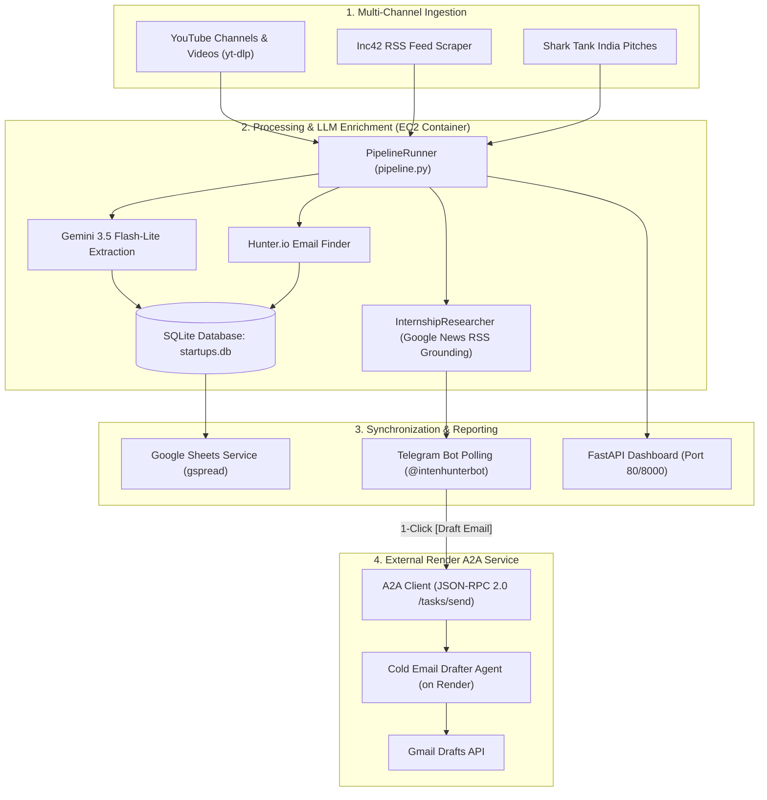

# 🚀 Startup Discovery & Career Strategy Agent — Complete Handover Document (In & Out)

> **Document Type:** Project Architecture, Setup, Operations & Handoff Guide  
> **Repository:** `Startup-DIscovery-Agent`  
> **Last Updated:** October 2026  
> **Status:** Fully Operational (Production on AWS EC2 + Render A2A)

---

## 📑 Table of Contents
1. [Executive Summary & What This System Does](#1-executive-summary--what-this-system-does)
2. [High-Level System Architecture](#2-high-level-system-architecture)
3. [Component Breakdown (The "Ins")](#3-component-breakdown-the-ins)
   - [Scraping & Discovery Pipeline](#31-scraping--discovery-pipeline)
   - [Verification & LLM Extraction](#32-verification--llm-extraction)
   - [Decision Maker Lead Generation (Hunter.io)](#33-decision-maker-lead-generation-hunterio)
   - [Internship Strategy & Research Engine](#34-internship-strategy--research-engine)
   - [Google A2A Agent Protocol (Gmail Draft Automation)](#35-google-a2a-agent-protocol-gmail-draft-automation)
   - [Telegram Interactive Bot & RAG](#36-telegram-interactive-bot--rag)
   - [Google Sheets Real-time Synchronization](#37-google-sheets-real-time-synchronization)
4. [Deployment Infrastructure (The "Outs")](#4-deployment-infrastructure-the-outs)
   - [AWS EC2 Server Specifications & Setup](#41-aws-ec2-server-specifications--setup)
   - [Docker Architecture & Services](#42-docker-architecture--services)
   - [Render A2A Service Integration](#43-render-a2a-service-integration)
5. [Database Schema & Data Flow](#5-database-schema--data-flow)
6. [Environment Variables Reference (`.env`)](#6-environment-variables-reference-env)
7. [Operational Runbook (How to Run, Test & Maintain)](#7-operational-runbook-how-to-run-test--maintain)
8. [Known Edge Cases & Troubleshooting Guide](#8-known-edge-cases--troubleshooting-guide)

---

## 1. Executive Summary & What This System Does

The **Startup Discovery & Career Strategy Agent** is an autonomous multi-agent pipeline designed to:
1. **Discover newly funded Indian startups** every morning from YouTube channels (Backstage with Millionaires, etc.), Inc42 RSS feeds, and Shark Tank India.
2. **Verify funding claims** using Gemini LLMs and cloud-resilient search grounding.
3. **Find decision makers** (Founders, CEOs, Talent Heads) on LinkedIn and enrich them with **Hunter.io verified email addresses**.
4. **Sync live startup and lead data** into a multi-tab Google Sheet (`BWM`, `Shark Tank India`, `Leads`).
5. **Conduct role-fit research** for candidate tracks (Product Management, AI Automation, Founder's Office).
6. **Deliver morning digests & interactive cards** to Telegram subscribers (`@intenhunterbot`).
7. **Execute Agent-to-Agent (A2A) handshakes**: With 1 tap in Telegram, it dispatches startup context to an external Render agent (`tele-bot-intern`) that generates a tailored cold email using your resume and saves it directly to your **Gmail Drafts**.

---

## 2. High-Level System Architecture



---

## 3. Component Breakdown (The "Ins")

### 3.1 Scraping & Discovery Pipeline
- **YouTube Ingestion (`services/youtube.py`):** Uses `yt-dlp` to crawl channel uploads (`@BackstageWithMillionaires`, etc.) looking back 24 hours. No YouTube API quota consumed.
- **Inc42 Scraper (`services/inc42_scraper.py`):** Parses the latest funding articles from Inc42's RSS feed without hitting aggressive anti-bot screens.
- **Shark Tank India (`services/shark_tank_scraper.py`):** Scrapes pitched startups, funding rounds, valuation, and investors.

### 3.2 Verification & LLM Extraction
- **LLM Extraction (`services/llm_extractor.py`):** Prompts `gemini-3.5-flash-lite` with structured output schemas to reliably parse startup names, amounts, investors, and rounds.
- **Web Verification (`services/web_verifier.py`):** Cross-checks funding claims via web search to calculate a `confidence_score` (0.0 to 1.0).

### 3.3 Decision Maker Lead Generation (Hunter.io)
- **LinkedIn Search (`services/linkedin_finder.py`):** Discovers CXOs, Founders, and HR heads using focused queries without paid LinkedIn scrapers.
- **Email Enrichment (`services/email_finder.py`):** 
  - Direct integration with Hunter.io API.
  - Queries by LinkedIn handle (`/v2/email-finder?linkedin_handle=...`) or domain + full name.
  - Built-in 7-day `ResearchCache` to prevent redundant credit consumption.
  - Monthly quota guard (tracks against 50 free searches/month).

### 3.4 Internship Strategy & Research Engine
- **Engine (`services/internship_researcher.py`):** 
  - Cloud-resilient Google News RSS fallback (`_fetch_search_snippets`) that prevents datacenter IP blocking or Gemini Search Grounding 429 quota exhaustion.
  - Generates structured evaluation for:
    - **Product Management & Strategy Fit (`pm_fit`)**
    - **AI Automation Fit (`ai_fit`)**
    - **Founder's Office Fit (`fo_fit`)**

### 3.5 Google A2A Agent Protocol (Gmail Draft Automation)
- **Client (`services/a2a_client.py`):** Implements the official Google Agent-to-Agent protocol over JSON-RPC 2.0.
- **Endpoint:** `https://tele-bot-intern.onrender.com/a2a`
- **Method:** `tasks/send`
- **Payload:** Formats startup details, mission, role fit, decision maker, and Hunter-verified email into `message.parts[0].text`.
- **Action:** The Render agent crafts a cold email matching your resume to the startup's current stage and saves it to your Gmail Drafts folder.

### 3.6 Telegram Interactive Bot & RAG
- **Script (`telegram_bot.py`):** Long-polling bot server under handle `@intenhunterbot`.
- **Features:**
  - `/start`: Interactive inline keyboard to toggle tracks (`PM`, `AI`, `Founder's Office`, `Active/Pause`).
  - `/ask <query>`: Natural language vector database search over discovered startups using ChromaDB/RAG.
  - `/search <query>`: Instant search for startups and their decision-maker leads.
  - **1-Click A2A Email Drafting:** Clicking `[✉️ Send to Email Agent (Draft Cold Email)]` triggers the background task and replies with draft confirmation and preview.

### 3.7 Google Sheets Real-time Synchronization
- **Script (`services/sheets.py`):**
  - Authenticates via service account `credentials.json` (`diksha-bot@intern-sorting-tele-bot.iam.gserviceaccount.com`).
  - Spreadsheet ID: `10c9xBTpxq9_dyIXvoAhWiypJYVpov8p-Cfly3rTnb84`
  - Dynamically detects the `Email ID` column (Column H) and auto-populates Hunter.io emails.

---

## 4. Deployment Infrastructure (The "Outs")

### 4.1 AWS EC2 Server Specifications & Setup
- **Region:** `ap-south-1` (Mumbai)
- **Instance ID:** `i-01d4bfb596bc633ac`
- **Instance Type:** `t3.small` (2 vCPU, 2 GB RAM — upgraded from `t3.micro` to eliminate OOM crashes).
- **Public IPv4:** `43.204.96.126` (Note: Changes if instance is stopped/started without an Elastic IP).
- **SSH Access:** Configured with authorized RSA key from development machine (`ssh ubuntu@43.204.96.126`).

### 4.2 Docker Architecture & Services
The application runs as a containerized stack managed via `docker-compose.yml`:
- **Directory on Server:** `/home/ubuntu/Startup-Discovery-Agent`
- **Container Name:** `startup-agent`
- **Port Mapping:** `0.0.0.0:80 -> 8000/tcp` (Dashboard exposed on port 80).
- **Volumes:**
  - `./startups.db:/app/startups.db` (Persistent SQLite database)
  - `./reports:/app/reports` (Generated daily markdown reports)
  - `./credentials.json:/app/credentials.json:ro` (Google service account credentials)
- **Processes inside Container (`run_all.py`):**
  1. `main.py --start-dashboard` (FastAPI web UI on port 8000)
  2. `telegram_bot.py` (Telegram bot polling server)
  3. `main.py --start-scheduler` (Standalone APScheduler running daily at 09:30 IST)

### 4.3 Render A2A Service Integration
- **Host URL:** `https://tele-bot-intern.onrender.com`
- **Card Endpoint:** `https://tele-bot-intern.onrender.com/.well-known/agent.json`
- **Task Endpoint:** `https://tele-bot-intern.onrender.com/a2a`

---

## 5. Database Schema & Data Flow

Database file: `startups.db` (SQLite)

### Primary Tables
1. **`startups`**:
   - `id`, `name`, `website`, `funding_amount`, `funding_amount_numeric`, `funding_round`, `investors` (JSON list), `industry`, `confidence_score`, `internship_researched` (Boolean).
2. **`processed_videos`**:
   - `video_id` (Primary Key), `title`, `url`, `channel`, `status` (`processed`, `ignored`, `error`), `processed_at`.
3. **`lead_profiles`**:
   - `id`, `startup_id`, `startup_name`, `name`, `role`, `linkedin_url`, `email` (Hunter.io verified), `confidence_score`.
4. **`users`**:
   - `id`, `telegram_chat_id`, `username`, `is_active`, `pm_interest`, `ai_interest`, `fo_interest`.
5. **`research_cache`**:
   - `id`, `startup_name`, `service_type` (`internship_research`, `web_verification`), `cached_json`, `updated_at` (7-day TTL).

---

## 6. Environment Variables Reference (`.env`)

```ini
# AI / LLM Configuration
GEMINI_API_KEY=AIzaSy...
GEMINI_MODEL=gemini-3.5-flash-lite

# Telegram Bot & Webhooks
TELEGRAM_BOT_TOKEN=8992910045:AAG_eDX-wRH47lFCTcFy3DlOy5mx0i6_RGg
WEBHOOK_URL=https://api.telegram.org/bot8992910045:AAG_eDX-wRH47lFCTcFy3DlOy5mx0i6_RGg/sendMessage?chat_id=5063530064&parse_mode=Markdown
TELEGRAM_WEBHOOK_URL=https://api.telegram.org/bot8992910045:AAG_eDX-wRH47lFCTcFy3DlOy5mx0i6_RGg/sendMessage?chat_id=5063530064&parse_mode=Markdown

# Database
DATABASE_URL=sqlite:///startups.db

# Google Sheets
GOOGLE_SHEETS_CREDENTIALS_JSON=credentials.json
GOOGLE_SHEETS_SPREADSHEET_ID=10c9xBTpxq9_dyIXvoAhWiypJYVpov8p-Cfly3rTnb84

# Scheduler & Pipeline
DAILY_RUN_TIME=09:30
SEARCH_LOOKBACK_HOURS=24
ONLY_SCAN_CHANNELS=true

# Hunter.io Email Finder
HUNTER_API_KEY=1962b90cb217ae581d61327930715f7ddb51c74d
HUNTER_MIN_LEAD_CONFIDENCE=0.6
HUNTER_MONTHLY_QUOTA=50

# External A2A Agent on Render
A2A_AGENT_URL=https://tele-bot-intern.onrender.com/a2a
```

---

## 7. Operational Runbook (How to Run, Test & Maintain)

### Connect to Server via SSH
From development machine:
```powershell
ssh ubuntu@43.204.96.126
```

### View Live Container Logs
```bash
sudo docker compose logs -f --tail=50
```

### Manually Trigger Daily Startup Discovery Pipeline
```bash
sudo docker exec startup-agent python main.py --run-pipeline
```

### Manually Trigger Internship Subscription Dispatch
```bash
sudo docker exec startup-agent python main.py --run-internships
```

### Test Google Sheets Connectivity
```bash
sudo docker exec startup-agent python check_sheets_connectivity.py
```

### Test Hunter.io Email Finder
```bash
sudo docker exec startup-agent python test_email_lookup.py --name "Chetan Reddy" --domain "confido.health"
```

### Deploying Future Code Changes to Server
```bash
cd /home/ubuntu/Startup-Discovery-Agent
git pull origin main
sudo docker compose down && sudo docker compose up -d --build
```

---

## 8. Known Edge Cases & Troubleshooting Guide

| Issue | Root Cause | Solution |
| :--- | :--- | :--- |
| **Telegram Status 409 Conflict** | Two processes polling `getUpdates` with the same token. | Ensure host `startup-agent.service` is stopped (`sudo systemctl stop startup-agent`). Only Docker container should run the bot. |
| **Google Sheets 403 / Invalid JWT** | Revoked or wrong `credentials.json` on disk. | Verify `credentials.json` belongs to `diksha-bot@intern-sorting-tele-bot.iam.gserviceaccount.com` and sheet is shared as Editor. |
| **Gemini 429 RESOURCE_EXHAUSTED** | Preview models (e.g. 3.6-flash) hitting free rate limits or Google Search tool quota. | Use `gemini-3.5-flash-lite`. The code automatically falls back to free Google News RSS search to bypass grounding quota. |
| **Telegram 400 Bad Request: chat not found** | User registered on an old bot token and has not clicked `/start` on `@intenhunterbot`. | Safe warning; user must message `@intenhunterbot` and send `/start` once. |
| **Gmail Draft not created via A2A** | Render cold email service is sleeping (Render free tier spin-down). | First request will wake it up (~30s). Subsequent requests take 2-4 seconds. |

---

*Handover document generated and committed to project root.*
